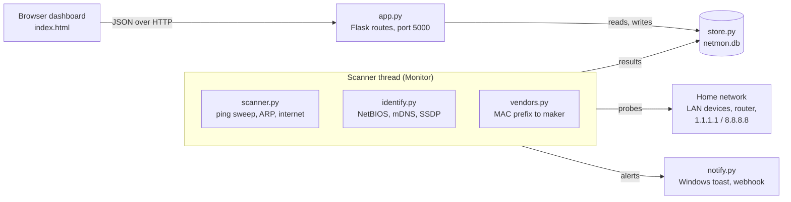

# Network Monitor: Design and Implementation

Network Monitor (`netmon`) is a locally run Python app that finds every device on the home
network, works out what each one is, tracks whether it is online, and alerts when something
changes. A browser dashboard shows the results.

This file is the source of truth for the design. Update it in the same commit as the code it
describes.

## Overview

**What it does**

- Discovers devices on the local subnet and lists each one's IP address, MAC address,
  manufacturer and best available name.
- Shows online/offline status, latency, 24-hour and 7-day uptime, and a log of status changes
  per device.
- Checks the router and the internet on every scan, so a router fault can be told apart from
  an internet outage.
- Alerts on new devices, on watched devices going offline or coming back, and on internet
  outages. Alerts go out as Windows desktop notifications and/or to a Discord, Slack or Teams
  webhook.

**Design goals**

- **No admin rights and no drivers.** Discovery uses only the OS `ping` and `arp` commands and
  plain UDP sockets. No Npcap/WinPcap and no raw packets.
- **One dependency.** Flask is the only third-party package; everything else is the Python
  standard library.
- **Local and private.** Data stays in a SQLite file on the PC. By default the dashboard listens
  on 127.0.0.1 only.
- **Web dashboard rather than a desktop GUI.** It needs no GUI toolkit and opens in any
  browser, including a phone when served on `0.0.0.0`.

**Non-goals (so far):** scanning across routers or VLANs, port scanning, reading the router's
own device list, and user accounts or authentication.

Setup and command-line options are in the [README](../README.md).

## Architecture

One Python process runs two things: a background scanner thread that loops forever, and the
Flask web server that the dashboard polls. The two share a single SQLite database guarded by a
lock.

**The scan cycle** (every `--interval` seconds, or at once when *Scan now* is pressed):

1. Ping every address in the subnet, 128 at a time.
2. Read the ARP cache for MAC addresses. A device counts as online if it answered ping or
   appeared in the ARP cache.
3. Identify each online device (reverse DNS, NetBIOS, mDNS), while one SSDP search runs
   alongside for the whole network.
4. Add the manufacturer (MAC vendor), OS hint and latency.
5. Write results to the database: upsert devices, record history, and work out what changed.
6. Send alerts for new, offline and returning devices.
7. Ping the router and the internet, store the result, and alert if the connection changed
   state.
8. Sleep until the next interval or a *Scan now* wake-up.

On a 9-device /24 network, a full cycle takes about 14 seconds.

**Modules**

| File | Responsibility |
| --- | --- |
| `netmon/__main__.py` | Command-line options, subnet choice, starts the app |
| `netmon/app.py` | `Monitor` scanner thread, alert wording, Flask routes |
| `netmon/scanner.py` | Ping sweep, ARP table, reverse DNS, gateway and internet checks, OS hint |
| `netmon/identify.py` | NetBIOS, mDNS/Bonjour and SSDP/UPnP lookups |
| `netmon/vendors.py` | MAC prefix to manufacturer, private-MAC detection |
| `netmon/store.py` | SQLite schema and migrations, history, uptime, settings |
| `netmon/notify.py` | Windows toast, macOS/Linux notifications, webhook |
| `netmon/templates/index.html` | The whole dashboard: HTML, CSS and JavaScript in one file |

## Discovery and identification

Discovery finds which addresses are in use; identification then asks each device, in several
ways, what it is. Every lookup is best effort: a device that doesn't speak a protocol just
times out, and nothing raises.

**Discovery**

- **Ping sweep.** The app runs the OS `ping` once per host (700 ms timeout) in a 128-thread
  pool. On Windows a reply only counts if the output contains `TTL=`, because Windows ping can
  exit 0 on "Destination host unreachable". The TTL and round-trip time are parsed from the
  same output (`time<1ms` is stored as 0.5 ms).
- **ARP cache.** `arp -a` is parsed for IP/MAC pairs (broadcast `ff:ff:ff:ff:ff:ff` is
  dropped). Phones and firewalled PCs often ignore ping but still answer ARP, so a device in the
  ARP cache after the sweep counts as online.
- **This PC** is always included. Its MAC comes from `uuid.getnode()`, and its OS and hostname
  come from Python directly, because some PCs fail to ping their own LAN address
  ("General failure").

**Identification**

| Method | How it asks | What it returns | Typical devices |
| --- | --- | --- | --- |
| Reverse DNS | `socket.gethostbyaddr` | DNS hostname | Networks whose router serves PTR records |
| NetBIOS | NBSTAT query for `*`, UDP 137, 1.5 s | Workstation name (unique name, suffix 0x00) | Windows PCs, NAS, Samba |
| mDNS / Bonjour | Unicast ("legacy") queries to the device on UDP 5353, 2 s: a reverse PTR, then `_services._dns-sd._udp.local`, then PTR and TXT for known service types | `.local` hostname, friendly name, model, device type, list of advertised services | Apple devices, printers, Chromecasts, HomeKit, Sonos |
| SSDP / UPnP | One multicast `M-SEARCH` for `upnp:rootdevice`, collected for 3 s, then the device's XML description fetched over HTTP | Friendly name, manufacturer, model, device type | TVs, media players, routers, consoles |
| MAC vendor | First 24/28/36 bits of the MAC, longest match wins | Manufacturer, with suffixes like "Inc." and "Co., Ltd." trimmed | Every device with a globally assigned MAC |
| Private MAC | Locally administered bit (0x02) in the first octet | Flag only | Phones and tablets using randomized MACs |
| OS hint | Ping TTL: ≤64, ≤128, higher | "Linux, Android, macOS or iOS", "Windows" or "Network equipment" | Anything that answers ping |

**Design choices**

- **mDNS is asked directly, not by multicast.** Replies then come back from the address that
  was queried, so a stateful firewall lets them through without opening an inbound port.
- **SSDP description URLs are only followed if they point back at the device that answered,**
  over plain HTTP, with reads capped at 256 KB.
- **The vendor list is Wireshark's `manuf` file** (about 3 MB, ~58,700 prefixes), downloaded to
  `manuf.txt` beside the database on first run and refreshed after 30 days. If the download
  fails, the scan carries on without vendors.
- **Display name priority:** the user's label, then UPnP/mDNS friendly name, then mDNS
  hostname, then NetBIOS name, then DNS name, then "<vendor> device".

## Data model

All state lives in one SQLite file (`netmon.db`, git-ignored). Timestamps are UTC ISO-8601
strings to the second, so they sort and compare as text.

| Table | One row per | Key columns |
| --- | --- | --- |
| `devices` | Known device | `mac` (unique), `ip`, `label`, `online`, `is_new`, `watch`, `first_seen`, `last_seen`; identification columns (`netbios_name`, `mdns_name`, `friendly_name`, `vendor`, `model`, `device_type`, `services`); ping columns (`ttl`, `latency_ms`, `os_hint`); alert state (`missed_scans`, `alerted`); `online_since` (start of the current online stretch, NULL while offline) |
| `scans` | Completed scan | `ts` |
| `samples` | Device per scan it was online in | `device_id`, `ts`, `latency_ms` |
| `events` | Status change | `device_id` (NULL for internet events), `ts`, `kind` (`new`, `online`, `offline`, `internet_down`, `internet_up`), `ip` |
| `wan` | Router/internet check | `ts`, `gateway_ms`, `internet_ms` (NULL = no reply) |
| `meta` | Key/value | `last_scan`, `internet_state`, and alert settings stored as `setting:<name>` |

**Device identity.** A device is matched by MAC address, because DHCP can hand it a new IP. A
device seen without a MAC is stored by IP, and that record gets the MAC attached once it is
learned. A device that changes IP keeps its label, history and watch flag.

**Update rules on each scan**

- Identification columns use `COALESCE(new, old)`, so a name survives a scan where the UDP
  lookup dropped.
- Ping columns are overwritten every scan, so they always show the latest reply.
- Nothing is flagged *new* on the very first scan, since everything would be.

**Online for.** `online_since` is set when a device is first seen or comes back after being
offline, and cleared when it misses a scan. The dashboard shows now − `online_since` as an
unbroken duration ("2h 15m"). For databases from before this column existed, it is backfilled
from the device's last `online`/`new` event, or `first_seen` when history doesn't go back that
far. Time when the app wasn't running is counted as online if the device was online before and
after.

**Uptime.** Uptime is the number of scans a device appeared in divided by the scans since it
was first seen, within the window (24 hours or 7 days). This counts presence directly and needs
no reconstruction of on/off intervals from events.

**Migrations and retention**

- On startup the store creates missing tables and indexes, then adds any missing `devices`
  columns with `ALTER TABLE`. Databases from earlier versions upgrade in place and keep their
  data.
- After every scan, rows older than 30 days are deleted from `scans`, `samples`, `wan` and
  `events`.
- *Forget* deletes the device together with its samples and events.

## Monitoring and alerts

Status shown on the dashboard changes on the first missed scan, but alerts wait for two in a
row, so a phone that naps through one scan doesn't trigger one.

**Device status**

- A device missing from a scan is marked offline at once, an `offline` event is logged, and its
  `missed_scans` counter goes up.
- When it reappears, an `online` event is logged and the counter resets.
- A **watched** device (bell icon) raises an *offline* alert when `missed_scans` reaches 2
  (about 2 minutes at the default interval). The `alerted` flag stops repeats, and the device's
  return raises one *back online* alert.
- A device seen for the first time logs a `new` event and raises a *new device* alert. If more
  than 3 join in one scan, they are combined into a single alert.

**Internet and router**

- After each scan the app finds the default gateway (`route print -4 0.0.0.0` on Windows,
  `ip route` elsewhere) and pings it. It then pings 1.1.1.1, falling back to 8.8.8.8, with a
  1.5 s timeout.
- The connection is declared **down** after 2 consecutive checks with no internet reply, and
  **up** on the next reply. The very first check after install sets the state without alerting.
- The down alert says whether the router still answered, which separates an ISP outage from a
  router problem.

**Alert settings** (the *Alerts…* dialog, stored in `meta`)

| Setting | Default | Effect |
| --- | --- | --- |
| New devices | On | Alert when an unseen device joins |
| Watched devices go offline | On | Offline and back-online alerts for belled devices |
| Internet connection drops | On | Down and restored alerts |
| Desktop notifications | On | Deliver as a desktop notification |
| Webhook URL | Empty | Also POST to this URL (http/https only) |

**Delivery channels** (`notify.py`)

- **Windows:** a toast raised through built-in PowerShell and the WinRT
  `ToastNotificationManager`, under PowerShell's app ID. The title and body travel in
  environment variables and are XML-escaped inside the script, so alert text can never be run
  as code.
- **macOS / Linux:** `osascript` or `notify-send` when available (written but not tested).
- **Webhook:** one JSON body that works for several services: `content` (read by Discord) and
  `text` (read by Slack and Teams), sent with a `User-Agent` header because Discord requires
  one.
- Each channel runs in its own thread, so a slow webhook never delays a scan. Failures are
  logged, not raised.

## Web API and dashboard

The dashboard is one static page that polls a small JSON API every 10 seconds, or every
2 seconds while a scan is running.

**API** (all JSON; request bodies use `Content-Type: application/json`)

| Method | Path | Purpose |
| --- | --- | --- |
| GET | `/` | The dashboard page |
| GET | `/api/devices` | All devices with 24h uptime, internet/router status, last scan time, scanning flag, subnet, interval |
| GET | `/api/devices/<id>/history` | 24h and 7d uptime, 24h latency samples, last 15 status changes |
| GET | `/api/events?limit=25` | Recent activity across the network (max 200) |
| POST | `/api/scan` | Start a scan now |
| POST | `/api/devices/<id>/label` | Rename (`{"label": "..."}`; empty clears it) |
| POST | `/api/devices/<id>/watch` | Turn offline alerts on/off (`{"watch": true}`) |
| POST | `/api/devices/<id>/ack` | Clear the NEW flag on one device |
| POST | `/api/devices/ack` | Clear the NEW flag on all devices |
| DELETE | `/api/devices/<id>` | Forget a device and its history |
| GET / POST | `/api/settings` | Read or update the alert settings |
| POST | `/api/notify/test` | Send a test alert on every enabled channel |

**Dashboard** (`templates/index.html`: plain HTML, CSS and JavaScript, with no build step and no
external libraries)

- **Header:** subnet, last scan time, and the *Alerts…*, *Mark all seen* and *Scan now*
  buttons.
- **Connection panel:** internet status, latency, today's uptime and a 24-hour latency
  sparkline; router address and latency.
- **Count cards:** Known, Online, Offline, New and Watched. Each card is also a filter.
- **Device table:** status, editable name with badges (This PC, NEW, Private MAC), IP, MAC,
  latency, 24h uptime, online for (time since it last came online), last seen, and buttons for
  seen, watch and forget. A text box filters by
  name, maker, model, IP or MAC. Clicking a column header sorts by it, and clicking again
  reverses the order. The default sort is IP; uptime, online for and last seen start high-to-low. Blank
  values always sort last, ties fall back to IP order so rows don't jump between refreshes, and
  the choice is remembered in the browser's `localStorage`.
- **Details row** (click a device): everything identified about it, 24h/7d uptime, a latency
  chart (gaps where the device was offline) and its recent status changes.
- **Recent activity:** network-wide feed of joins, departures, returns and internet outages.
- **Alerts dialog:** the settings above plus a *Send test alert* button.

The page follows the system light/dark theme. It won't redraw while a name is being edited, and
all device-supplied text is HTML-escaped before display.

## Testing

All testing so far has been manual or done with ad hoc scripts on the development PC
(Windows 11, a 192.168.0.0/24 home network). The repo has no automated test suite yet.

| Area | How | Result |
| --- | --- | --- |
| Discovery | Live scans | 7–9 devices found with IPs and MACs, in about 10 s (about 14 s with identification) |
| Vendor lookup | Live scan | Maker found for every non-private MAC |
| mDNS | Live scan, repeated | Network printer identified every time with name, model, type and services |
| Device identity | Simulated scans on an in-memory database | IP change keeps the same record; a MAC is attached to an IP-only record; new and offline states are correct |
| Alerts and uptime | Simulated scans | New-device alert; offline alert only on the 2nd miss; one back-online alert; uptime fractions correct |
| Internet state | Simulated checks + live check | Down after 2 failures, up on recovery |
| Webhook | Local HTTP receiver | Correct `content`/`text` payload; alert types that are switched off are skipped |
| Desktop toast | Test button | PowerShell reported success |
| Dashboard | Browser | Bell, details history, activity feed and settings dialog work; no console errors |

## Known limitations

- **SSDP/UPnP can return nothing on Windows networks set to the *Public* profile.** The
  firewall blocks replies to multicast searches. Setting the network to *Private* may enable it
  (untested).
- **Few devices report a name** when the router serves no reverse DNS and phones don't answer
  mDNS. Users can label devices by hand.
- **Offline detection lags by up to about a minute,** because Windows keeps ARP entries briefly
  after a device leaves.
- **A phone that changes its private MAC appears as a second device.** There is no merge action
  yet.
- **Same subnet only.** MAC addresses aren't visible across routers.
- **Uptime starts when history begins,** so devices offline at that moment show low uptime at
  first.
- **No authentication or CSRF protection.** Any web page can trigger simple POSTs such as
  *Scan now* or *Mark all seen*. Serving on `0.0.0.0` exposes the dashboard to everyone on the
  LAN.
- **Flask's development server** is used. It is fine for one local user, but it prints a
  warning.

## Possible next steps

- Fix offline-detection lag, add device merging, and harden the API (custom header check;
  password when serving on `0.0.0.0`).
- Unit tests for the packet parsers, vendor lookup and store, run by GitHub Actions.
- Run in the background from a system-tray icon, or as a packaged `.exe`; switch to the
  Waitress web server.
- Wake-on-LAN, an opt-in port check, CSV export, and tags or notes per device.
